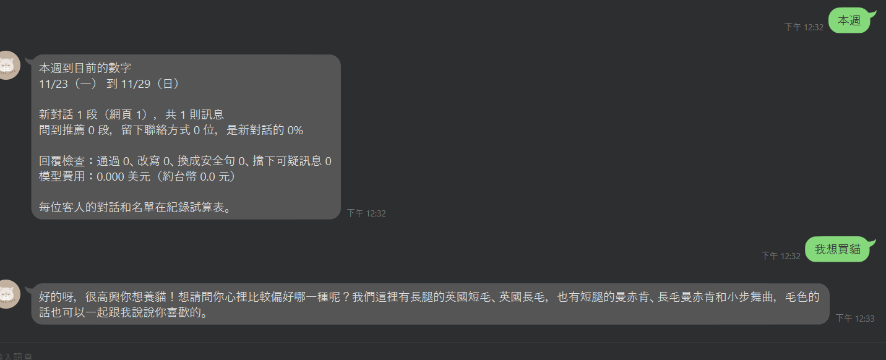
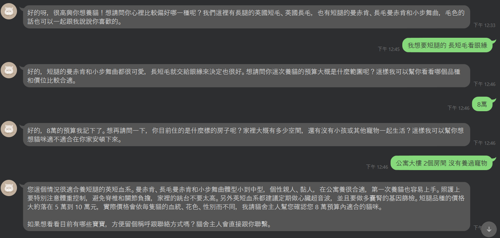
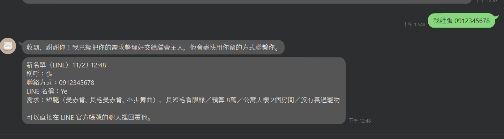

# 單元 9：部署到 LINE 官方帳號，名單推播與每週排程

## 我在做什麼

金霸貓舍是我在新竹新豐經營的 TICA 註冊貓舍。客人多半是從 Meta 廣告點進來私訊，由我一句一句回覆，常常在問到價格前後就沒有下文。我的專題是做一個 AI 選種顧問：在 IG 和 Facebook 私訊裡，先陪客人把品種、預算和生活條件問清楚，用貓舍自己的資料回答，再把有意願的客人留成名單，交給我本人接手。

做法分兩階段。前半學期在 Coze 上把 agent 的零件一個一個拆開來學：模型、prompt、記憶、知識庫、工具，每週用測試集記錄哪裡會壞、要花多少。後半學期照老師的建議，用 Claude Code 自己做一個客服 agent，輸出 API 接到 IG 和其他通路，期末用在貓舍的真實營運上。

目前進度：單元 0 到 8 完成，網頁版已經上線：[gimba-agent.gimba-agent.workers.dev](https://gimba-agent.gimba-agent.workers.dev)。本週是單元 9 部署，第一個真實通路是貓舍的 LINE 官方帳號。

---

**日期：** 2026/11/23
**本週對應課綱單元：** 單元 9
**平台：** Claude Code 自建，執行在 Cloudflare Workers；LINE 官方帳號（Messaging API）；對話記憶與週統計存在 Cloudflare KV；對話紀錄寫進 Google 試算表
**測試條件：** 模型 Claude Haiku 5.5，thinking 關閉，知識庫 v2，Guardrail 沿用單元 8。先在本機用假的 LINE 事件跑 14 項自動測試（`npm run test:line`），部署後用手機實際聊一輪完整的選貓對話。

---

## 結論先行

這週把顧問接上貓舍真正在用的 LINE 官方帳號。**選貓流程、知識庫、Guardrail 一行都沒改**，只多寫了「訊息怎麼進來、怎麼送出去、記憶放哪裡」。手機實測從「我想要短腿的」到留下電話只用了 4 則訊息，推薦內容逐句對過知識庫，沒有編造。**客人留下電話的同一分鐘，我的 LINE 就收到新名單**，上面有稱呼、電話和他的完整需求；每週一早上 9 點，排程會自動把上週的對話數、名單數、檢查結果和費用推給我。LINE 上的成本跟網頁一樣，一段選貓對話約台幣 1 角。最重要的發現是：**同一個大腦換一個入口，真正要重想的是記憶放在哪裡**。網頁的記憶在客人的瀏覽器裡，要簽章防偽造；LINE 沒有瀏覽器，記憶改存在伺服器上，反而更單純。

---

## 結論與思考摘要

這週如果只能留一句話，就是：一個大腦、多個入口，入口只負責收發和記憶。

W6–7 寫程式時就決定把選貓流程放在一個函式裡（`handleMessage`），網頁只是其中一個入口。這週驗證了這個決定：LINE 入口大約 200 行，全部在處理 LINE 自己的規矩，例如驗簽章、先回 200 再慢慢回覆、同一則訊息可能被送兩次、貼圖怎麼辦。客人在手機上看到的追問順序、推薦內容、固定邀請句，跟網頁一模一樣，因為它們本來就是同一段程式。

第二個收穫，是「部署」不只是讓程式跑起來，而是讓它接上營運。老闆最在意的不是顧問多會聊，而是名單有沒有馬上到手上。以前名單寫進試算表，要我自己去翻；現在留下電話的同一分鐘手機就響。每週一的週報則讓我不用打開試算表，也知道上週顧問接了幾段對話、有幾個人留名單、Guardrail 攔了幾次、花了多少錢。

第三個收穫，是測試要先在本機做完，才接真的帳號。我先寫了一支測試，用本機的假金鑰簽出假的 LINE 事件送進程式，14 項全部通過才部署。真的接上 LINE 之後，只花了兩次手機對話就確認完成，中間沒有出現需要回頭改程式的錯誤，只有一個顯示上的小問題。

---

## 本週知識點：用自己的話重新定義

**Webhook**
平台在有事情發生時，主動打一通電話（HTTP 請求）到我指定的網址。客人在 LINE 傳訊息，LINE 就把這則訊息送到 `/line/webhook`。我不用一直去問「有沒有新訊息」，訊息會自己送上門。

**簽章驗證**
任何人都可以對我的網址送請求，所以要確認請求真的來自 LINE。LINE 用只有我和它知道的 Channel secret，對整個請求內容算一個簽章放在標頭裡，我用同一把鑰匙再算一次，對得上才處理。單元 8 網頁記憶的簽章是同一個原理，只是那次是我簽、我驗。

**非同步回覆**
LINE 希望 webhook 很快就回應，但顧問加上 Guardrail 一輪要 4 到 8 秒。做法是先回 LINE「收到了」，再在背景跑選貓流程，跑完才用回覆 API 把答案送出去。等待時客人會看到 LINE 的「輸入中」動畫。

**伺服器端記憶**
對話記憶存在伺服器上，客人碰不到。這週用 Cloudflare KV，一個 LINE 使用者一份，30 天沒講話就自動忘記。

**冪等（Idempotency）**
同一件事做一次或做兩次，結果都一樣。LINE 有時會重送同一則訊息，如果每次都處理，客人會收到兩次回覆、記憶也會多記一輪。每則訊息有編號，處理過的編號記一小時，重送的就略過。

**回覆和推播**
回覆是回應客人剛傳的訊息，推播是主動傳給某個人。回覆客人用回覆 API，通知我新名單和週報用推播。推播會算進官方帳號每月的免費訊息額度，回覆不會。

**排程（Cron）**
在固定的時間自動執行一段程式。這週設定成每週一早上 9 點（UTC 的週一 1 點）統計上週數字，推播給我。

### 名詞之間的關聯

客人在 LINE 傳訊息，LINE 透過 webhook 送到我的程式；程式先做簽章驗證，再用冪等檢查擋掉重送，接著先回 200，在背景做非同步回覆。這一輪的需求和對話存進伺服器端記憶，答案用回覆送給客人；如果客人留下聯絡方式，再用推播通知我。每一輪的數字累加起來，由排程在週一整理成週報推給我。

---

## 實作紀錄

### 一、這週加了什麼

```
gimba-agent/
├── src/line.ts           ← 新增：LINE webhook、驗簽章、KV 記憶、回覆與推播
├── src/stats.ts          ← 新增：每週計數、週報文字
├── src/index.ts          ← 接上 /line/webhook、網頁名單也推播、週一排程
├── wrangler.toml         ← KV 綁定、cron「0 1 * * MON」
└── tests/line.mjs        ← 新增：npm run test:line，本機模擬 LINE
```

**LINE 入口。** 收到 webhook 先驗簽章，不對就回 401。接著逐一處理事件：
- 加好友：回固定的自我介紹。
- 文字訊息：從 KV 讀出這位客人的記憶，交給同一個 `handleMessage`，把新記憶存回 KV，再用回覆 API 送出答案。
- 貼圖、圖片：回固定句「我目前只看得懂文字訊息喔」。
- 群組訊息：不理。

試算表裡 LINE 客人的對話編號，是 LINE 使用者 ID 雜湊後的前 10 碼（例如 line-3fa8…），原始 ID 不寫進紀錄。

**新名單推播。** 不論網頁還是 LINE，客人留下聯絡方式那一輪，程式就推播一則「新名單」給我，內容是稱呼、聯絡方式、LINE 名稱和需求（品種、毛色、預算、居住環境、經驗）。LINE 來的名單最後一行提醒我可以直接在官方帳號的聊天裡回他。

**每週統計與排程。** 每一輪都把數字加進這一週的計數：新對話（分網頁和 LINE）、走到推薦的對話、留下聯絡方式的人數、推薦時客人想要的品種、Guardrail 的結果、模型費用。每週一早上 9 點，排程把上週的週報推給我。我也可以隨時在 LINE 傳「本週」或「上週」。

### 二、先在本機測：14 項全部通過

接真的 LINE 之前，我寫了一支測試 `npm run test:line`。本機沒有 LINE 的 access token 時，程式不會真的呼叫 LINE，而是把「本來要送出去的訊息」暫存起來給測試讀；測試用本機的假 secret 簽出假的 LINE 事件，送進 webhook。

| 測試 | 結果 |
|---|---|
| 簽章是假的、沒有簽章 | 都回 401 拒絕 |
| LINE 後台的「驗證」按鈕（空事件） | 回 200 |
| 加好友 | 回自我介紹 |
| 傳貼圖 | 回「我目前只看得懂文字訊息」 |
| 5 輪選貓對話 | 每輪都記得前面說過的，第 4 輪推薦曼赤肯並接上固定邀請句，第 5 輪回感謝句 |
| 新名單推播 | 我收到稱呼、電話、需求 |
| 同一則訊息重送 | 只回一次 |
| 我傳「本週」 | 收到本週數字 |
| 觸發週一排程 | 收到上週週報 |

本機測試的回覆不會送到 LINE，也不會寫進試算表，不會弄髒真的紀錄。

### 三、部署與 LINE 後台設定

部署時 Cloudflare 自動建立了存記憶用的 KV，週一的排程也一起登記。LINE 這邊要做的是：在官方帳號啟用 Messaging API，回應設定打開 Webhook、關掉自動回應訊息和加入好友的歡迎訊息（不然加好友會收到兩段歡迎詞），再把 Webhook 網址填成 `https://gimba-agent.gimba-agent.workers.dev/line/webhook`。

三個金鑰（Channel secret、Channel access token、我自己的 LINE user ID）都用 `wrangler secret put` 在終端機輸入，只存在 Cloudflare，不寫進程式、不進 GitHub。部署後確認：沒有簽章的請求被拒絕、本機測試用的暫存端點在線上是關的、網頁聊天室照常回覆。

### 四、手機實測

我先用自己的帳號傳「本週」，馬上收到數字；接著傳「我想買貓」，顧問照業務順序先問品種，列出五個品種，也請我說喜歡的毛色。



接著從頭聊一輪完整的選貓對話：

- 「我想要短腿的 長短毛看眼緣」：顧問記下短腿、毛長不限，問預算。
- 「8萬」：問居住環境。
- 「公寓大樓 2個房間 沒有養過寵物」：這一句同時回答了居住環境和經驗，顧問沒有再問一次經驗，直接推薦短腿三個品種，接上固定邀請句。
- 「我姓張 0912345678」（測試用的假資料）：回固定感謝句。



推薦內容我逐句對過知識庫：體型小到中型、親人黏人、適合第一次養、要控制體重、跳台不要太高、每年做心臟超音波、多囊腎基因篩檢、短腿 5 到 10 萬、價格看血統花色性別，全部在知識庫裡。8 萬預算內有哪幾隻，交給我本人確認。

留下電話的同一分鐘，我的 LINE 收到新名單：



小瑕疵：推薦那一則用「您」，前面幾則都用「你」，不影響使用，之後可以在 prompt 統一。

### 五、實測抓到的小問題

第一次傳「本週」時，費用寫成「0.000 美元（約台幣 0.0 元）」。那時只有一句「你好」，費用不到 0.0005 美元，四捨五入成 0，看起來像沒花錢。改成金額很小時多顯示一位小數，例如「0.0044 美元」，本機重跑測試通過，下次部署生效。

### 六、成本

LINE 入口沒有多呼叫模型，成本跟網頁一樣：一段 6 輪的選貓對話約 0.0035 美元，約台幣 1 角。新增的是 Cloudflare KV 的讀寫（每輪讀一次記憶、寫一次記憶、寫一次計數）和 LINE 推播，以貓舍的訊息量，都在免費額度內。

---

## 業界怎麼解

背景工作交給佇列。我用的是「先回 200，再在背景跑」，背景工作有時間上限，萬一模型很慢就可能做不完。訊息量大的系統會把每則訊息丟進佇列（例如 Cloudflare Queues），由另一個工作者慢慢處理，失敗還能重試。

計數要用能保證一致的儲存。我把每週數字存在 KV，兩則訊息同時進來時，可能少算一次。正式系統會用資料庫的交易或 Durable Objects 這類「一次只讓一個人改」的儲存。對貓舍的訊息量，少算一次可以接受，完整紀錄以試算表為準。

真人接手要有開關。客服系統通常有「轉真人」的狀態：真人一接手，機器人就安靜，直到真人結束。我的顧問現在還沒有這個開關，我在官方帳號後台手動回客人時，顧問也會繼續回。

多通路平台。很多店家用第三方平台把 LINE、Messenger、IG 的訊息收在同一個收件匣。我的做法是自己寫入口，每個通路一個 webhook，共用同一個大腦。

---

## 踩坑與排除過程

PowerShell 擋住 npx。第一次在終端機設金鑰時，出現「這個系統上已停用指令碼執行」。原因是 PowerShell 不允許執行 `npx.ps1`，改打 `npx.cmd` 就可以，不需要改系統的安全設定。

`wrangler secret put` 後面接的是名字，不是值。第一次我把金鑰的值直接打在指令後面，這樣值會被當成名字，還會留在終端機的歷史紀錄裡。正確做法是 `put LINE_CHANNEL_SECRET`，按 Enter 後等提示出現，再貼上值，貼的時候畫面不會顯示。

金鑰出現在截圖和聊天裡就要換。設定時有一張後台截圖拍到了完整的 Channel secret，我就到 LINE Developers 重新發行一組，舊的立刻失效。之後截圖都先把 secret 和 token 遮起來。

本機測試不能寫進真的試算表。本機的 `.dev.vars` 有試算表的網址，如果測試也寫進去，紀錄會混進假對話。改成本機沒有 LINE access token 時，LINE 的對話不寫試算表。

---

## 對應到我的專案

第一件事，顧問第一次站上貓舍真正的營運通路。之前只有網頁版，要客人點連結才用得到；現在加官方帳號好友就能直接聊，這是客人本來就在用的地方。

第二件事，名單即時推播解決了最痛的那一段。Meta 廣告來的客人常在問完價格後就沒下文，我越早聯絡越好。以前名單在試算表裡等我去看，現在留下電話的同一分鐘我就知道，而且需求已經整理好，不用從頭問。

第三件事，週報讓我用數字經營，而不是靠感覺。每週一早上就知道上週有幾段對話、幾個人走到推薦、幾個人留名單、Guardrail 攔了幾次。如果名單數掉下來，我可以回頭看是廣告、知識庫，還是顧問的問法出了問題。

---

## 老師的迴饋（若有）

本週沒有新的迴饋。延續 W5 老師擔心的「部署能力」：這週顧問已經部署在 Cloudflare，並接上貓舍真實的 LINE 官方帳號，用手機完成一輪從選貓到留名單的實測。

---

## 下週計畫

接上 Facebook 粉絲專頁和 IG 私訊，照 LINE 的做法各加一個入口，大腦不動。同時整理我用 Claude 做 Meta 廣告素材、協助上廣告的過程，讓「廣告帶進客人 → 顧問接住 → 名單推給我」整條路串起來。顧問本身也還有幾個功能要加，包括「真人接手後顧問就安靜」的開關。單元 10 期末成果展示等這些完成後再做。
